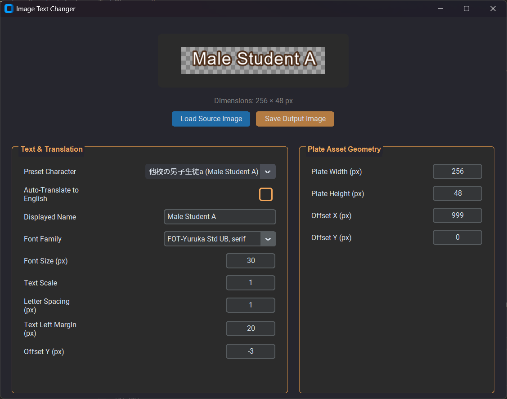

# Image Text Changer

A desktop tool for re-rendering the text on game **nameplate assets** — e.g. replacing a
baked-in Japanese character nameplate (他校の男子生徒a…) with its English translation
(*Other Male Student A*), while keeping the original plate artwork pixel-perfect.

> **As far for now, I've only tested on Hamidashi Creative Visual Novel** || [VNDB Link](https://vndb.org/v27449)

Built with [customtkinter](https://github.com/TomSchimansky/CustomTkinter) +
[Pillow](https://python-pillow.org/), with optional
[Tesseract OCR](https://github.com/tesseract-ocr/tesseract) support for auto-detecting
the original text when loading a source image.



---

## Features

- 🖼️ **Live preview** — the loaded source plate is shown under the rendered text on a
  checkerboard transparency backdrop; every setting re-renders instantly (debounced).
-  **Preset characters** — dropdown of known Japanese character IDs with their English
  translations, plus a functional **Auto-Translate to English** toggle.
- 🔤 **Game-accurate text rendering** — white fill with brown outline, per-character
  letter spacing, horizontal **Text Scale** applied to the *text layer only* (the plate
  artwork is never stretched or distorted).
- 🧩 **Plate Asset Geometry** panel — output canvas size and source offsets for cropping
  / positioning game assets.
- 🔎 **Optional OCR** — on load, Tesseract (`jpn+eng`) tries to detect the original text
  and match it against the preset list. The app works fine without Tesseract installed.
- 🅰️ **Smart font resolution** — CSS-like family strings such as
  `FOT-Yuruka Std UB, serif` are resolved to real installed font files (Windows /
  macOS / Linux font directories are scanned), with graceful fallbacks.
- 💾 **PNG export with transparency** preserved.

## Requirements

- Python **3.9+**
- `customtkinter`, `pillow`, `pytesseract`
- *(optional)* Tesseract OCR binary with `eng` + `jpn` language data
- *(optional, cosmetic)* the **FOT-Yuruka Std UB** font for the authentic game look —
  any installed font works via the fallback chain.

## Installation

```bash
# 1. clone
git clone https://github.com/<your-username>/image-text-changer.git
cd image-text-changer

# 2. python dependencies
pip install customtkinter pillow pytesseract
```

### Tesseract OCR (optional)

| Platform | How |
|---|---|
| **Windows** | Install from [UB-Mannheim/tesseract](https://github.com/UB-Mannheim/tesseract/wiki). The default path `C:\Program Files\Tesseract-OCR\tesseract.exe` is auto-detected; otherwise uncomment the `pytesseract.pytesseract.tesseract_cmd = ...` line at the top of `image_text_changer.py`. Select the `japanese` + `english` language packs during setup. |
| **Ubuntu/Debian** | `sudo apt install tesseract-ocr tesseract-ocr-jpn` |
| **macOS** | `brew install tesseract tesseract-lang` |

If Tesseract is missing, loading images still works — OCR is simply skipped with a
console notice.

## Usage

```bash
python image_text_changer.py
```

1. **Load Source Image** — pick a nameplate PNG (transparency supported). The preview,
   the *Dimensions* label and the plate geometry update.
2. Pick a **Preset Character** (or type anything into **Displayed Name**). With
   **Auto-Translate** checked, selecting a preset fills in the English name.
3. Tune the text until it matches the in-game look:

   | Setting | Default | Effect |
   |---|---|---|
   | Font Family | `FOT-Yuruka Std UB, serif` | resolved to an installed font file |
   | Font Size (px) | `24.8` | text height |
   | Text Scale | `0.71` | horizontal scale of the **text layer only** |
   | Letter Spacing (px) | `-3` | extra advance per character |
   | Text Left Margin (px) | `16` | left inset of the text block |
   | Offset Y (px) | `-7` | vertical nudge of the text |

4. Adjust **Plate Asset Geometry** (output canvas width/height and the position the
   source is pasted at) if you need to crop/shift the asset.
5. **Save Output Image** — exports a transparent PNG ready for your mod/asset pipeline.


## How the rendering works

```
canvas (Plate Width × Plate Height, transparent)
  └─ source image pasted UN-SCALED at (Offset X, Offset Y)   → no distortion
  └─ text layer (transparent, same size)
       ├─ characters drawn one by one (letter spacing)
       ├─ white fill + brown outline via Pillow stroke_width
       ├─ layer resized horizontally by Text Scale
       └─ composited at (Text Left Margin, 0)
```

Because scaling touches only the text layer, the plate artwork in the saved PNG is
byte-identical to the source pixels (this is asserted by the test suite).

## Project structure

```
image_text_changer.py     # the application (GUI + renderer + font resolver)
make_sample_plate.py      # regenerates the bundled sample asset
sample_plate.png          # sample clean nameplate asset (208×48, transparent)
test_app.py               # headless smoke test (runs the real GUI)
docs/                     # screenshots used by this README
```

## Running the tests

The smoke test launches the real GUI, loads `sample_plate.png`, asserts that
background pixels are untouched (no distortion), that text renders, and that the
settings panels lay out correctly.

```bash
# Windows / macOS (has a display):
python test_app.py

# headless Linux:
sudo apt install xvfb
Xvfb :99 -screen 0 1280x860x24 &
DISPLAY=:99 python3 test_app.py
```

Expected final line: `SMOKE TEST OK`. It also writes `out_preview.png` and (when
possible) `out_window.png` for visual inspection.

## Troubleshooting

| Problem | Fix |
|---|---|
| `tesseract is not installed or it's not in your PATH` | Install Tesseract (see above) or ignore — OCR is optional. On Windows check `tesseract_cmd` at the top of the script. |
| OCR returns garbage / nothing | Make sure the `jpn` traineddata is installed; the tool retries with `eng` only and finally skips OCR. |
| Text uses a different font than expected | The named family wasn't found on this machine; the resolver fell back (Arial → Liberation/DejaVu Sans → first available font). Install *FOT-Yuruka Std UB* for the exact look. |
| Preview looks empty | Check that *Plate Width/Height* are > 0 and that the source actually has opaque pixels in that region. |

## License

MIT — see your license file of choice. This tool is intended for personal game
modding / translation projects; respect the original asset copyrights.
